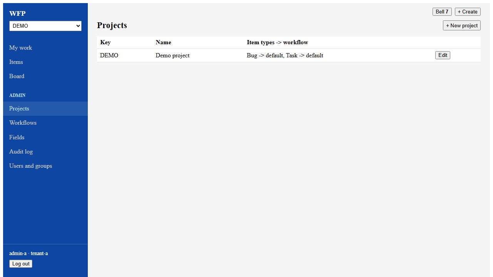
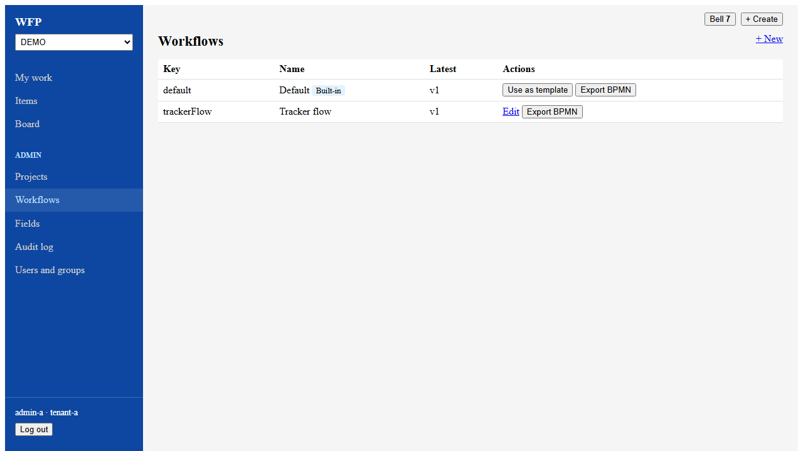
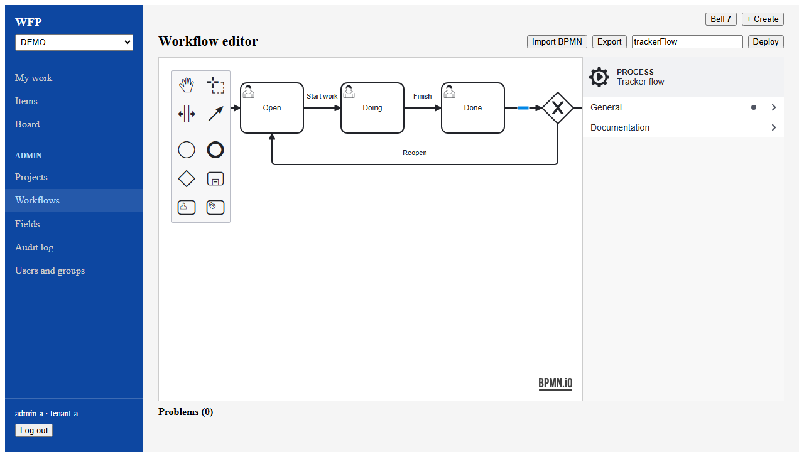
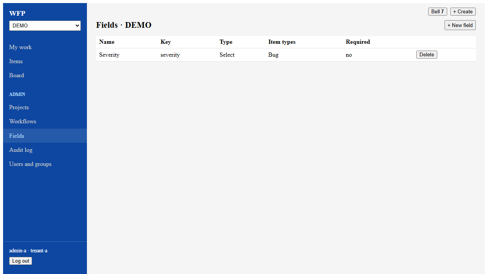
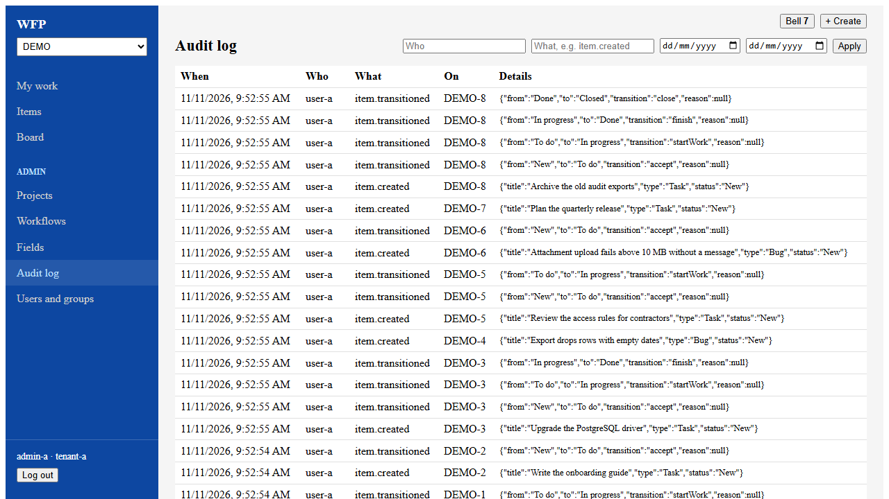

# Admin Manual — Workflow Platform

## Table of Contents

1. [Overview](#overview)
2. [Architecture](#architecture)
3. [Admin Section](#admin-section)
4. [Projects](#projects)
5. [Workflows](#workflows)
6. [Workflow Editor](#workflow-editor)
7. [Fields](#fields)
8. [Audit Log](#audit-log)
9. [Keycloak Administration](#keycloak-administration)
10. [Docker Deployment](#docker-deployment)
11. [Kubernetes Deployment](#kubernetes-deployment)
13. [Troubleshooting](#troubleshooting)

---

## Overview

The **Admin** section of the tracker app gives administrators the tools to:

- Create projects and map their item types to workflows
- Design and deploy BPMN workflows with a visual editor
- Configure custom fields by project and item type
- View the audit log of all platform activity

**URL:** `http://localhost:5175` (local development)

---

## Architecture

```
┌─────────────┐
│ Tracker app │
│  :5175      │
└──────┬──────┘
       │ nginx /api proxy
       │
         ┌──────▼───────┐
         │   Workflow   │
         │custom fields,│
         │notifications,│
         │    audit     │
         │    :8081     │
         └──────┬───────┘
                │
         ┌──────┴──────┐
         ▼             ▼
    ┌────────┐    ┌────────┐
    │Postgres│    │Keycloak│
    │ :5433  │    │ :8180  │
    └────────┘    └────────┘
```

### API Routing

The web app's nginx proxies `/api/` unchanged to `app:8081`. The service serves the
external paths itself (`/api/workflow/**`, `/api/fields/**`, `/api/notifications/**`, `/api/audit/**`)
and validates the JWT on every request. In development, Vite proxies `/api` to `localhost:8081`.

### Events

Workflow events (`task.created`, `task.assigned`, `task.completed`, `task.delegated`, `process.started`) are handled inside app: each one creates its in-app notification and its audit entry in the same transaction as the change. There is no message broker.

---

## Admin Section

Open the app and log in with an admin account (for example `admin-a` / `password`). The **Admin** section appears in the sidebar only for the `admin` role, and `/admin` pages redirect anyone else to My work. The API enforces the same role.

**Users and groups** opens the Keycloak console. See [Keycloak Administration](#keycloak-administration).

---

## Projects



Click **+ New project**, then enter:

- **Key** — 2 to 10 capital letters or digits, starting with a letter. Item keys are built from it, such as `PROJ-12`.
- **Name**
- **Item types** — at least one, each using a deployed workflow.

Projects cannot be edited after they are created.

---

## Workflows



The table shows the latest version of each deployed workflow. **Edit** opens it in the editor, and **Export BPMN** downloads it. Click **+ New** to start a new workflow or to import a file.

---

## Workflow Editor



### BPMN Editor

The editor is based on [bpmn-js](https://bpmn.io/toolkit/bpmn-js/) with Flowable extensions. It provides:

- **Visual canvas** — drag-and-drop BPMN elements (tasks, events, gateways, sequence flows)
- **Properties panel** (right sidebar) — configure element properties
- **Palette** (left sidebar) — the elements a tracker workflow may use: start and end events, user task (a status), service task, exclusive gateway and subprocess. Boundary timers, event subprocesses and parallel gateways are made through an element's replace menu (the wrench)
- **Problems** (below the canvas) — the tracker rules the diagram breaks, checked as you edit. Invalid elements are outlined in red with a **!** badge; click a problem to select its element

### Supported BPMN Elements

| Element        | Description                                    |
|----------------|------------------------------------------------|
| Start Event    | Process entry point                            |
| End Event      | Process exit point                             |
| User Task      | Human task assigned to a user or group         |
| Service Task   | Automated task (Java class, expression, delegate) |
| Exclusive Gateway | Decision point (XOR split/join)             |
| Parallel Gateway  | Parallel split/join                          |
| Sequence Flow  | Connection between elements                    |

### Status Category

User tasks and subprocesses have a **Status** group with a **Status category**: Open, To do, In progress or Done. A user task with a category is a status of the tracker workflow; the category decides the board column. Every status needs one, and at least one status must be Done.

### Flowable Properties

The properties panel includes Flowable-specific configuration:

#### User Task Properties
| Property         | Description                                         |
|-----------------|-----------------------------------------------------|
| Assignee        | User assigned to the task (e.g., `${initiator}`)    |
| Candidate Users | Comma-separated list of candidate users             |
| Candidate Groups| Comma-separated list of candidate groups            |
| Form Key        | Form identifier for custom rendering                |
| Due Date        | Task deadline expression                            |
| Priority        | Task priority (integer)                             |

#### Service Task Properties
| Property            | Description                                     |
|--------------------|-------------------------------------------------|
| Java Class         | Fully qualified class name for JavaDelegate     |
| Expression         | UEL expression (e.g., `${myService.execute()}`) |
| Delegate Expression| Expression resolving to a JavaDelegate          |
| Result Variable    | Variable to store the result                    |

#### Async Properties (all activities/gateways/events)
| Property    | Description                                |
|------------|---------------------------------------------|
| Async      | Enable async execution                      |
| Async Before | Execute before the element asynchronously |
| Async After  | Execute after the element asynchronously  |
| Exclusive    | Exclusive async execution (no parallel)   |

### Importing BPMN Files

You can import existing BPMN 2.0 XML files into the visual editor:

1. Click **Import BPMN** in the top-right toolbar
2. Select a `.bpmn` or `.bpmn20.xml` file from your computer
3. The diagram renders in the canvas and the workflow name auto-fills from the filename
4. Review and edit the process in the visual editor
5. Click **Deploy** to deploy it to the Flowable engine

Compatible sources for BPMN files include:
- [Flowable GitHub repo](https://github.com/flowable/flowable-engine) — official samples (Vacation Request, Helpdesk, Review Sales Lead, etc.)
- Any BPMN 2.0 compliant modeler (Camunda Modeler, Signavio, etc.)
- Exported files from this platform's **Export** button

> **Note:** Files using the legacy `activiti:` namespace are supported by Flowable but `flowable:` is recommended.

Sample BPMN files are included in `e2e/samples/` for testing:
- `vacation-request.bpmn20.xml` — multi-step vacation approval with manager review, approval/rejection gateway, and resubmission loop
- `review-sales-lead.bpmn20.xml` — complex workflow with embedded subprocess, parallel gateway, error boundary events, and CRM integration task

### Exporting BPMN Files

Click **Export** to download the current diagram as a `.bpmn` XML file. This preserves all Flowable-specific properties (assignee, candidateGroups, formKey, async settings, etc.).

### Editing Existing Workflows

On the Workflows screen, click **Edit** on any workflow to load its BPMN XML into the visual editor. You can modify the diagram and redeploy — Flowable auto-increments the version number.

### Deploying

1. Create or import your BPMN diagram in the editor
2. Enter a **workflow name** in the top-right input
3. Click **Deploy**
4. The process is sent to the app and deployed to the Flowable engine
5. You'll be redirected to the Workflows screen

A tracker workflow (one that uses status categories) is checked against the tracker rules first; if it breaks any, the deploy is refused and the problems are listed below the canvas. The process needs a valid process `id`; deploy marks it executable itself.

---

## Fields

Custom fields attach structured data to items without changing the workflow. **Fields** shows the definitions for the project selected at the top left.



Click **+ New field**, then enter:

- **Name** — the label users see
- **Key** — the identifier, used in filters as `cf.<key>`
- **Type** — Text, Long text, Number, Date, Date and time, Yes or no, or Select
- **Required**
- **Item types** — tick the types it applies to, or none for all of them
- **Options** — for Select, one per line

A key can repeat within a project only if the item types do not overlap. **Delete** removes the definition. Values already stored on items are kept.

---

## Audit Log

The audit log records every significant change, in the same transaction as the change.



Filter by **Who** (a username), **What** (an event type) and a date range, then click **Apply**.

### Event Types

| Event Type          | Description                               |
|---------------------|-------------------------------------------|
| `project.created`   | A project was created                     |
| `item.created`      | An item was created                       |
| `item.updated`      | An item changed, with the field changes   |
| `item.transitioned` | An item moved to another status           |
| `item.commented`    | A comment was added to an item            |

---

## Keycloak Administration

Keycloak manages authentication and tenant isolation.

**Admin Console:** `http://localhost:8180/admin`
**Realm:** `workflow-platform`

### Realm Structure

- **Realm:** `workflow-platform` — single realm for all tenants
- **Clients:**
  - `wfp-web` — OIDC client for the tracker app
- **Client Scopes:**
  - `tenant` — adds `tenant_id` claim to JWT
  - `profile` — adds `preferred_username`, `given_name`, `family_name`
  - `email` — adds `email` claim
  - `roles` — adds `realm_access.roles` claim

### Managing Users

1. Navigate to Keycloak admin console → Users
2. Click **Add User**
3. Set username, email, first/last name
4. Under **Credentials**, set a password
5. Under **Attributes**, add `tenant_id` attribute with the tenant value (e.g., `tenant-a`)

### Tenant Isolation

Tenant isolation is enforced through the `tenant_id` JWT claim:

1. Each user has a `tenant_id` attribute in Keycloak
2. The `tenant` client scope maps this attribute to the JWT `tenant_id` claim
3. Each service reads the claim from the validated token and filters all database queries by tenant
4. A user without a `tenant_id` attribute gets **403 Forbidden** on every API call, so set the attribute for every user

### Default Configuration

| User      | Tenant   | Attributes                        |
|-----------|----------|-----------------------------------|
| `admin-a` | tenant-a | `tenant_id=tenant-a`             |
| `admin-b` | tenant-b | `tenant_id=tenant-b`             |

---

## Docker Deployment

### Starting the Full Stack

```bash
# Build all images
docker compose -f docker/docker-compose.yml build

# Start all containers
docker compose -f docker/docker-compose.yml up -d

# Check container status
docker compose -f docker/docker-compose.yml ps
```

### Container Overview

| Container          | Image              | Port  | Description            |
|-------------------|--------------------|-------|------------------------|
| wfp-postgres      | postgres:16-alpine | 5433  | Database (all schemas) |
| wfp-keycloak      | keycloak/keycloak:25 | 8180 | Identity provider      |
| wfp-app           | (built)            | 8081  | Workflow engine, custom fields, notifications, audit |
| wfp-web           | (built)            | 5175  | Tracker app            |

### Startup Order

The docker-compose file defines dependencies:

1. **PostgreSQL** starts first (health check: `pg_isready`)
2. **Keycloak** starts after PostgreSQL is healthy
3. **Backend services** start after PostgreSQL is healthy
4. **Frontend containers** start after app

### Viewing Logs

```bash
# All services
docker compose -f docker/docker-compose.yml logs -f

# Single service
docker compose -f docker/docker-compose.yml logs -f app

# Last 100 lines
docker compose -f docker/docker-compose.yml logs --tail=100 app
```

### Database Schemas

PostgreSQL uses separate schemas per service (created by `docker/init-db.sql`):

| Schema          | Service              |
|----------------|----------------------|
| `workflow`     | app (including custom fields, notifications and audit) |
| `keycloak`     | Keycloak             |


---

## Kubernetes Deployment

The platform includes Helm charts for Kubernetes deployment.

### Chart Structure

```
helm/
├── charts/
│   ├── app/
│   └── web/
└── workflow-platform/          # Umbrella chart
    ├── Chart.yaml
    └── values-local.yaml
```

### Deploying

```bash
# Update dependencies (pulls bitnami charts for PG and Keycloak)
helm dependency update helm/workflow-platform/

# Install
helm install wfp helm/workflow-platform/ \
  -f helm/workflow-platform/values-local.yaml

# Upgrade
helm upgrade wfp helm/workflow-platform/ \
  -f helm/workflow-platform/values-local.yaml
```

### Configuration

Override values in `values-local.yaml` or pass `--set` flags:

```yaml
# Example: override image tag
app:
  image:
    tag: "latest"

# Example: override database host
global:
  postgresql:
    host: my-pg-host.example.com
```

---

## Troubleshooting

### Common Issues

| Symptom | Cause | Fix |
|---------|-------|-----|
| Service fails to start with `DataSource` error | Missing database schema | Run `docker/init-db.sql` against PostgreSQL |
| Duplicate `@FilterDef` error | An entity declares `@FilterDef(name = "tenantFilter")` | The filter is defined once in `entity/package-info.java`; entities use `@Filter` only |
| JWT validation fails | Keycloak not reachable | Check Keycloak is running and `issuer-uri` is correct |
| Frontend shows "Loading..." | API calls failing | Check browser console for errors; verify app is running |
| Port 5432 conflict | Local PostgreSQL running | Docker maps PG to port 5433 to avoid conflicts |
| `gradlew` permission denied | File not executable | Run `git update-index --chmod=+x gradlew` |
| Flowable + H2 test failures | Wrong H2 mode | Use `MODE=LEGACY` in JDBC URL, not `MODE=PostgreSQL` |

### Health Checks

Verify all services are healthy:

```bash
curl http://localhost:8081/actuator/health  # app
```

### Useful Commands

```bash
# Get a JWT token
curl -s -X POST 'http://localhost:8180/realms/workflow-platform/protocol/openid-connect/token' \
  -d 'grant_type=password&client_id=wfp-web&username=admin-a&password=password' \
  | jq .access_token -r

# Deploy a BPMN process
curl -X POST http://localhost:8081/api/workflow/deployments \
  -H "Authorization: Bearer $TOKEN" \
  -H "Content-Type: application/json" \
  -d '{"name":"My Process","bpmnXml":"<xml>..."}'

# List a project's items
curl "http://localhost:8081/api/items?project=PROJ" \
  -H "Authorization: Bearer $TOKEN"

# View audit log
curl http://localhost:8081/api/audit \
  -H "Authorization: Bearer $TOKEN"
```
