# C4 Level 3 — Component Diagram: App (the backend service)

The workflow service is the core of the platform. It wraps the Flowable 7.1 BPMN engine and exposes the project, work item, workflow deployment, custom field, notification and audit APIs.

```mermaid
C4Component
    title App — Component Diagram

    Container_Ext(portals, "Tracker app", "nginx proxies /api/** to this service")
    ContainerDb_Ext(postgres, "PostgreSQL", "Schema: workflow")
    System_Ext(flowableEngine, "Flowable Engine", "Embedded BPMN engine (in-process)")

    Container_Boundary(workflowSvc, "App") {

        Component(projectCtrl, "ProjectController", "REST Controller", "POST /api/projects<br/>GET /api/projects")
        Component(itemCtrl, "ItemController", "REST Controller", "POST /api/items<br/>GET /api/items, /api/items/{key}<br/>PATCH /api/items/{key}<br/>POST /api/items/{key}/transitions")
        Component(projectSvc, "ProjectService", "Service", "Creates projects with item types; checks that each workflow is a tracker workflow")
        Component(itemSvc, "ItemService", "Service", "Creates, changes and moves items; implements WorkflowRunListener; writes transition, audit and notification rows in the same transaction")
        Component(workflowEngine, "FlowableWorkflowEngine", "WorkflowEngine adapter", "latestVersion, describe, start, transition (tenant-checked)")
        Component(runEvents, "FlowableRunEvents", "Flowable Listener", "ACTIVITY_STARTED on item runs → statusEntered, runEnded")

        Component(deployCtrl, "DeploymentController", "REST Controller", "POST /api/workflow/deployments (deploy BPMN)<br/>GET /api/workflow/deployments (list definitions)<br/>GET /api/workflow/deployments/{id}/bpmn (export XML)<br/>DELETE /api/workflow/deployments/{id}")
        Component(auditCtrl, "AuditController", "REST Controller", "GET /api/audit (filter by entity, user, event type, time)")
        Component(notifCtrl, "NotificationController", "REST Controller", "GET /api/notifications<br/>GET /api/notifications/unread-count<br/>PUT mark-read, mark-all-read")

        Component(deploySvc, "DeploymentService", "Service", "Deploys BPMN XML to Flowable, retrieves process definitions and BPMN XML")
        Component(commentSvc, "CommentService", "Service", "Comments on work items (JPA, not Flowable comments)")
        Component(notifSvc, "NotificationService", "Service", "Turns task events into in-app notification rows, in the caller's transaction; lists and marks them read")
        Component(auditSvc, "AuditService", "Service", "Records each domain event as an audit entry in the caller's transaction; queries the audit trail")
        Component(tenantResolver, "CurrentTenantIdResolver", "Hibernate filter parameter", "Supplies the tenant from TenantContext to the auto-enabled tenantFilter")
        Component(securityConfig, "SecurityConfig", "Spring Security", "OAuth2 resource server, JWT validation, public endpoint whitelist")

        Component(commentRepo, "CommentRepository", "JPA Repository", "CRUD for Comment entity")
    }

    Rel(portals, projectCtrl, "HTTP/JSON")
    Rel(portals, itemCtrl, "HTTP/JSON")
    Rel(projectCtrl, projectSvc, "Calls")
    Rel(itemCtrl, itemSvc, "Calls")
    Rel(projectSvc, workflowEngine, "WorkflowEngine")
    Rel(itemSvc, workflowEngine, "WorkflowEngine")
    Rel(workflowEngine, flowableEngine, "RepositoryService, RuntimeService, TaskService")
    Rel(runEvents, itemSvc, "WorkflowRunListener")
    Rel(itemSvc, notifSvc, "createNotification", "same transaction")
    Rel(itemSvc, auditSvc, "record", "same transaction")
    Rel(portals, deployCtrl, "HTTP/JSON")
    Rel(portals, notifCtrl, "HTTP/JSON")
    Rel(portals, auditCtrl, "HTTP/JSON")

    Rel(deployCtrl, deploySvc, "Calls")
    Rel(itemCtrl, commentSvc, "Calls")
    Rel(auditCtrl, auditSvc, "Calls")
    Rel(notifCtrl, notifSvc, "Calls")

    Rel(deploySvc, flowableEngine, "RepositoryService")

    Rel(commentSvc, commentRepo, "JPA")
    Rel(commentRepo, postgres, "JDBC")

    UpdateLayoutConfig($c4ShapeInRow="4", $c4BoundaryInRow="1")
```

## Component Inventory

| Component | Type | Responsibility |
|-----------|------|---------------|
| ProjectController | REST | Create and list projects with their item types |
| ItemController | REST | Create, list, get, change and transition work items |
| ProjectService | Service | Validates the key and that each item type's workflow is a tracker workflow |
| ItemService | Service | Item lifecycle; status copy, transition rows, audit and notifications in one transaction |
| FlowableWorkflowEngine | `WorkflowEngine` adapter | The only engine API work items use |
| FlowableRunEvents | Engine Listener | Reports status changes of item runs to `WorkflowRunListener` |
| DeploymentController | REST | BPMN deploy, list definitions, export XML, delete |
| NotificationController | REST | List notifications, unread count, mark read |
| AuditController | REST | Query the audit trail |
| DeploymentService | Service | Wraps Flowable RepositoryService |
| CommentService | Service | JPA-based comment CRUD |
| NotificationService | Service | Creates in-app notifications from task events in the same transaction; reads and marks them |
| AuditService | Service | Records audit entries from events in the same transaction; serves `/api/audit` |
| CurrentTenantIdResolver | Hibernate filter parameter | Supplies the tenant from `TenantContext` to the auto-enabled `tenantFilter` |
| SecurityConfig | Config | OAuth2 JWT resource server setup |

## Notes for Editors

- **Adding a new endpoint group** (e.g., Attachments API): Add a Controller + Service component pair, connect the controller to the portals and the service to the relevant repository/Flowable service.
- **Flowable stays in `com.wfp.workflow.engine.flowable`**: DeploymentService, FlowableConfig, FlowableExceptionHandler, FlowableWorkflowParser, FlowableWorkflowEngine, FlowableRunEvents and TransitionConditions live there, and `EngineBoundaryTest` (ArchUnit) fails the build if any other main class depends on `org.flowable`.
- **Flowable engine is embedded** (in-process, not a separate container). It uses the same PostgreSQL schema (`workflow`) and manages its own `ACT_*` tables alongside the application's `wf_*` tables.
