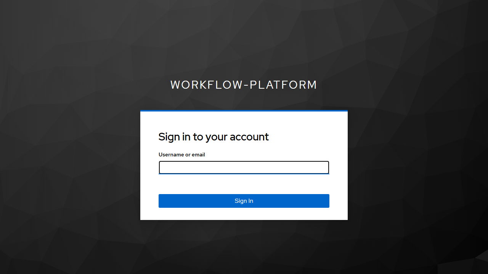
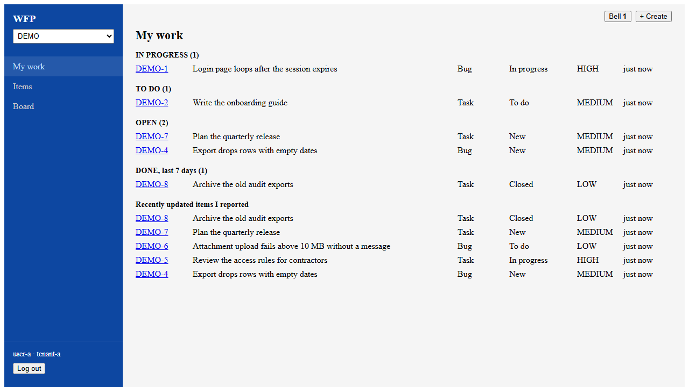
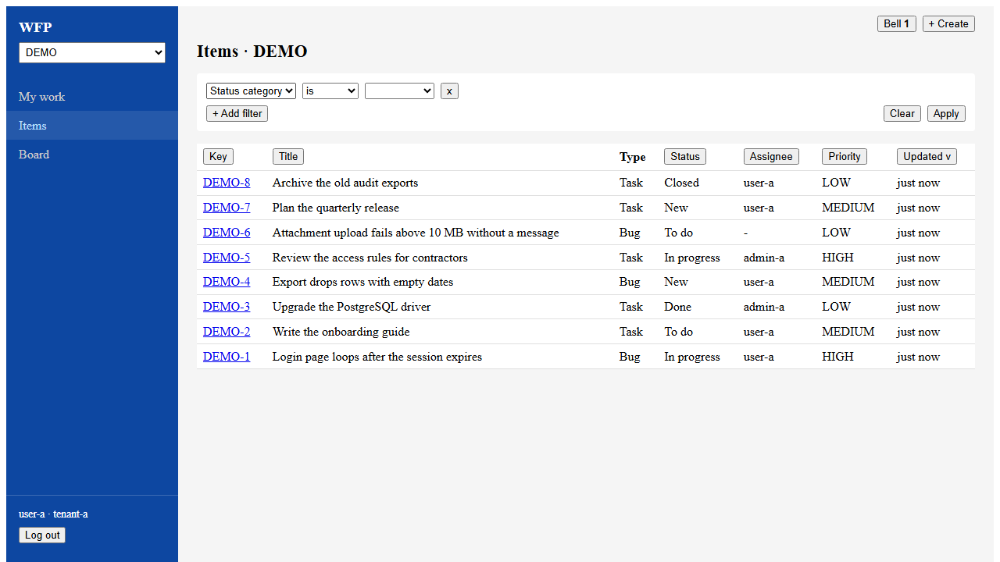
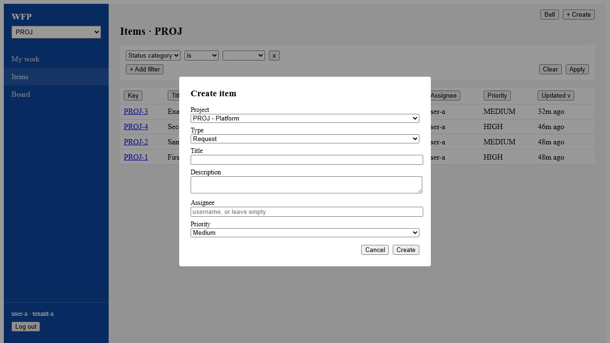
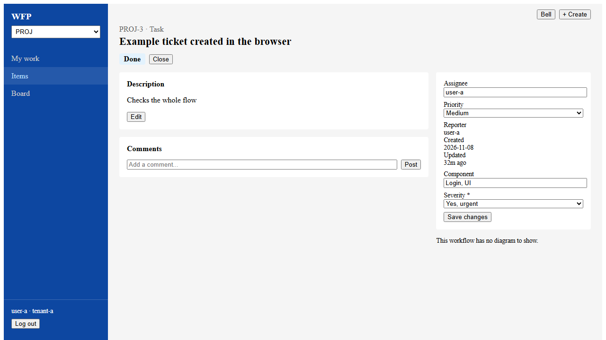
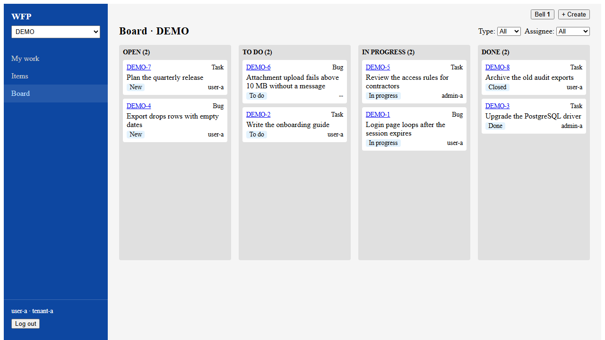

# User Manual — Workflow Platform

## Table of Contents

1. [Getting Started](#getting-started)
2. [Login](#login)
3. [My Work](#my-work)
4. [Items](#items)
5. [Creating an Item](#creating-an-item)
6. [Item Detail](#item-detail)
7. [Board](#board)
8. [Notifications](#notifications)
9. [Multi-Tenant Isolation](#multi-tenant-isolation)
10. [Troubleshooting](#troubleshooting)

---

## Getting Started

The Workflow Platform is a work item tracker. Each item belongs to a project, has a type such as Bug or Task, and moves through the statuses of its workflow. You can:

- See the items assigned to you
- Create, filter and sort items
- Move items through their workflow from the item page or the board
- Comment on items and be notified about changes

**URL:** `http://localhost:5175` (local development)

The project selector at the top left chooses the project that **Items**, **Board** and **+ Create** start in.

### Prerequisites

- A user account provisioned in Keycloak (the identity provider)
- A modern web browser (Chrome, Firefox, Edge)

---

## Login

1. Open the URL above. You are redirected to the Keycloak login page.
2. Enter your username and password and click **Sign In**.
3. You land on **My work**.

### Default Users

| Username  | Tenant    | Role  | Password |
|-----------|-----------|-------|----------|
| `admin-a` | tenant-a  | admin | password |
| `user-a`  | tenant-a  | user  | password |
| `admin-b` | tenant-b  | admin | password |
| `user-b`  | tenant-b  | user  | password |

Administrators also see the **Admin** section in the sidebar, described in the [Admin Manual](admin-manual.md).

---

## My Work

**My work** lists the items assigned to you across all projects, grouped by status category. Done items are shown for the last 7 days. Below them are the recently updated items you reported.

---

## Items

**Items** lists the current project's items, 25 to a page.

- Click a column heading to sort by it. Click again to reverse the order.
- Click **+ Add filter** to add a row of field, operator and value, then **Apply**. Rows are combined with AND. **Clear** removes them all.
- Custom fields are marked **(cf)** in the field list.
- Type `me` as the value of Assignee or Reporter to mean yourself.
- With **is any of**, select several values, or type them separated by commas. To type a value that contains a comma, write it as `\,`.

Greater-than and less-than on custom fields compare text, so dates in `YYYY-MM-DD` form order correctly but numbers do not.

---

## Creating an Item

Click **+ Create** at the top right of any page.

Choose the project and type, then enter a title. The custom fields shown depend on that project and type, and a `*` marks a required one. Assignee is a username and can be left empty.

---

## Item Detail

Click an item's key to open it.

- The buttons next to the status move the item through its workflow. If the status has steps to finish, each one has a **Complete** button.
- **Edit** changes the description.
- Change the assignee, priority or custom fields on the right, then click **Save changes**.
- **History** lists status changes and field changes, newest first.
- Add a comment below the description. The reporter and assignee are notified, except whoever wrote it.
- The diagram shows the workflow with the current status highlighted.

---

## Board

**Board** shows the current project's items in four columns: Open, To do, In progress and Done. The column is the status category, and the label on the card is the item's actual status.

Drag a card to another column to move it:

- If one transition leads there, it runs.
- If several do, you choose which one.
- If none does, the card stays where it is and a message explains why.

Filter the board by type or assignee with the lists at the top right.

---

## Notifications

The bell at the top right shows how many notifications you have not read, and updates every 30 seconds. Click it to see them. Clicking one marks it as read and opens its item. **Mark all read** clears the count.

You are notified when an item is assigned to you, and when an item you reported or are assigned to changes status or gets a comment.

---

## Multi-Tenant Isolation

The platform supports multiple tenants (organizations). Each tenant's data is completely isolated:

- You can only see projects, items and notifications belonging to your tenant
- Tenant membership is determined by your Keycloak account
- There is no way to access another tenant's data

---

## Troubleshooting

| Issue | Solution |
|-------|----------|
| "Loading..." stuck on screen | Check that all backend services are running. Verify the API health at `http://localhost:8081/actuator/health` |
| Redirected to login repeatedly | Your JWT token may have expired. Clear browser cookies and log in again |
| "There are no projects yet" | Ask an administrator to create a project |
| A drop on the board is refused | The workflow has no transition from the item's status to that column |
| "This workflow has no diagram to show" | The workflow was deployed without a layout. Everything else on the item works |
| Notifications not appearing | The bell updates every 30 seconds. You are not notified about your own changes |
